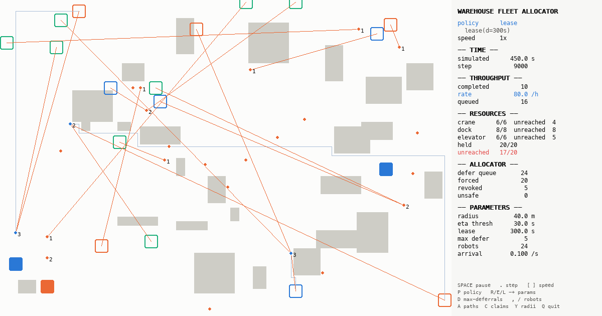

# Autonomous Warehouse Fleet Allocator

A deterministic 2D simulation measuring how **spatial admission control**
affects resource-allocation throughput in a warehouse robot fleet.

This is a research simulation built to produce defensible numbers, not a visual
demo. Every design decision serves reproducibility and measurement.



---

## The problem: early binding

In classical resource allocation, a process granted a resource uses it
immediately. The grant and the use are the same instant, so the allocator can
reason about them as one event.

A warehouse robot breaks that assumption. A robot can be granted a crane while
it is **200 metres away** from that crane. The crane is now locked. It will stay
locked, doing nothing, for the entire two-minute journey — while a second robot
parked ten metres from it sits idle, starving, because the crane is "in use".

That is **early binding**: the gap between *granted* and *actually used*. The
allocator's books say the crane is busy. The warehouse floor says it is sitting
there empty.

This project measures that gap directly and asks whether making the allocator
aware of *where things are* recovers the wasted time.

---

## What is actually being compared

The system is a **two-layer allocator**:

```
request -> [ AdmissionPolicy ] -> [ SafetyChecker: standard Banker's ] -> grant / defer
```

The safety layer is the textbook Banker's algorithm, **unmodified**. It is not
the contribution and it is not a variant of anything. The contribution is the
admission layer in front of it, which decides whether a request should even be
*considered* given where the requester is standing.

Four admission policies are compared on identical replayed workloads:

| Policy | Rule | Why it might work | How it fails |
|---|---|---|---|
| `null` | Admit everything | Classical baseline | Full early-binding waste |
| `radius` | Admit if euclidean distance <= r | Cheap proximity proxy | Straight-line distance ignores walls: a robot 20 m away behind racking has a worse ETA than one 200 m down a clear aisle |
| `eta` | Admit if A\* path cost <= threshold | Sees the actual map | A\* per request is expensive at scale |
| `lease` | Admit anyone, attach an arrival deadline, revoke on expiry | Attacks early binding *directly* rather than by proxy | Revocation churn under contention |

Comparing all four **is** the experiment. Building only the radius policy would
produce no evidence that the radius idea is correct.

---

## Install

Requires Python 3.11 or newer.

```bash
git clone <this-repo> && cd SWA

# with uv (recommended)
uv venv --python 3.12
uv pip install -r requirements.txt

# or with stdlib venv
python3.12 -m venv .venv
.venv/bin/pip install -r requirements.txt
```

`make venv` does the uv path for you.

---

## Run the simulation

Interactive, with the live view and controls:

```bash
python -m warehouse_allocator --policy lease --seed 42 --duration 600
```

Headless, printing derived statistics:

```bash
python -m warehouse_allocator --policy lease --seed 42 --headless --duration 3600
```

Every parameter is available on the command line (`--radius`, `--eta-threshold`,
`--lease-duration`, `--max-deferrals`, `--robots`, `--rate`, `--robot-speed`,
`--grid-width`, `--dt`, …). Run with `--help` for the full list.

### Live controls

Everything adjustable on the command line is also adjustable while running:

| Key | Effect |
|---|---|
| `SPACE` | pause / resume |
| `.` | single step |
| `[` `]` | speed multiplier, up to 64x fast-forward |
| `P` | cycle policy through all four, live |
| `R` / `E` / `L` | radius / ETA threshold / lease duration (`SHIFT` to decrease) |
| `D` | max deferrals |
| `,` `/` | remove / add a robot |
| `;` | task arrival rate |
| `A` `C` `Y` | toggle A\* paths, claim lines, proximity radii |
| `Q` | quit |

**Any mid-run parameter change permanently marks the run non-comparable**, emits
a `ParameterChanged` event, and raises a warning banner. Interactively tweaked
runs are for building intuition; they must never be reported as data.

### Reading the live view

- **Grey blocks** are racking (impassable).
- **Squares** are resources, coloured by class (blue crane, orange elevator,
  green dock). **Filled** means a robot has arrived and is using it. **Hollow**
  means it is granted to a robot that has *not yet arrived* — this is early
  binding, and every hollow square is a wasted resource.
- **Circles** are robots, coloured by state; the small number beside one is how
  many resources it is holding.
- **Orange lines** connect a robot to every resource it has claimed but not
  reached. A screen full of long orange lines is a fleet burning capacity on
  reservations it cannot yet use.

---

## Run the experiments

```bash
make experiment SEEDS=1,2,3,4,5,6,7,8,9,10,11,12
make sweep
make figures
```

Or directly:

```bash
python -m warehouse_allocator.experiments.runner --seeds 1,2,3,4,5 --duration 3600
python -m warehouse_allocator.experiments.sweep  --seeds 1,2,3,4,5 --duration 3600
```

The runner generates **one trace per seed and replays it against every policy**,
so no comparison is ever made across different workloads. Results are written to
`results/` as one CSV per run plus `summary.csv`, each carrying the full
`SimConfig` JSON as a header comment for provenance.

Aggregates use at least 5 seeds with 95% confidence intervals. Single-seed
results are not reportable — the seed-to-seed spread here is wide enough to
reverse a ranking.

---

## How to read the figures

All figures land in `results/` as 300 dpi PNG and PDF.

**`fig1_throughput_by_policy`** — the headline. Tasks completed per simulated
hour, with 95% CI error bars. Throughput is the primary metric because mean wait
time is trivially gamed: reject aggressively enough and the rejected robots stop
counting as waiting at all.

**`fig2_wait_distribution`** — wait spread by policy, as percentiles. Wait is
measured from *first request* to *final grant* including every deferral, so
refusing a robot cannot disguise itself as an improvement.

**`fig3_parameter_sweep`** — throughput against each admission threshold, as
small multiples (the axes carry different units and must not share a scale).
Reporting one arbitrary threshold would be weak evidence; the curve shows
whether an optimum exists at all.

**`fig4_robot_state_area`** — where fleet time actually goes over the run.

**`fig5_held_vs_unused`** — **the central figure.** The full bar is how long each
resource class was locked to some robot. The inner bar is how much of that time
the holder had not yet arrived. The gap between them is early-binding waste. The
whole project exists to measure and shrink that gap.

---

## Results

See **[docs/RESULTS.md](docs/RESULTS.md)** for the measured findings, including
the cases where admission filtering does **not** help.

Headline: resources spend the large majority of their held time waiting for an
absent holder, and `lease` is the only policy that meaningfully reduces this —
but it does not buy a statistically supported throughput win, and it makes one
resource class measurably worse.

---

## Documentation

| Document | Contents |
|---|---|
| [docs/ALGORITHM.md](docs/ALGORITHM.md) | The two-layer allocator, Banker's walked through with worked safe and unsafe examples, each policy's justification and failure mode |
| [docs/RESULTS.md](docs/RESULTS.md) | Measured findings with numbers, including adverse ones |
| [docs/ARCHITECTURE.md](docs/ARCHITECTURE.md) | Module map, data flow, the determinism contract, the rendering boundary |
| [PROGRESS.md](PROGRESS.md) | Build log, per stage, with verification output and deviations |

---

## Development

```bash
make test     # full pytest suite
make lint     # ruff + black --check + mypy --strict
make format   # apply formatting
```

The determinism guarantee is load-bearing for every number this project
produces, and is enforced by test: same seed reproduces the same run bit for
bit, and a rendered run matches a headless one exactly.
